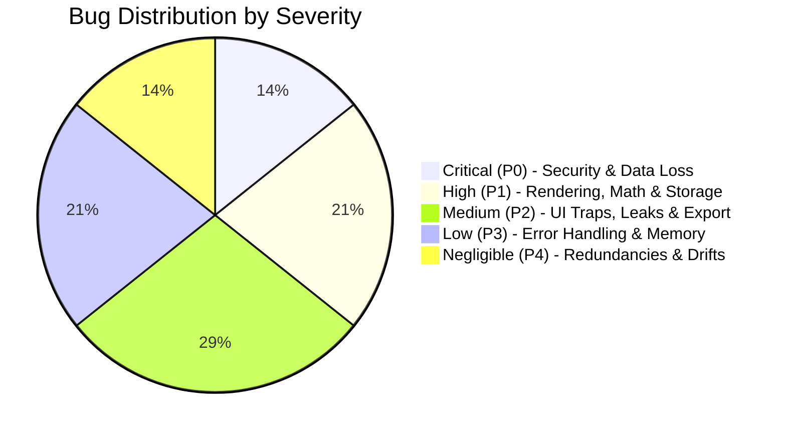
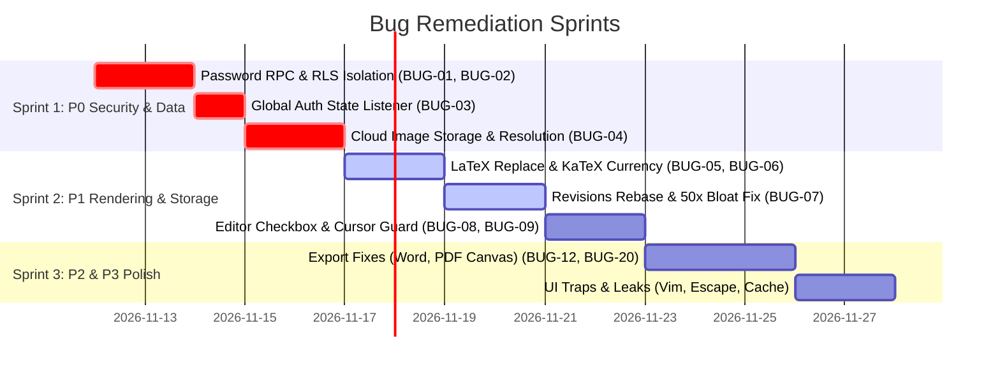

# Comprehensive Functional Flows & Architecture Bug Audit: MD Creator

> **Audit Date:** November 2026  
> **Target Application:** MD Creator (Web / Desktop / PWA)  
> **Audited Layers:** Frontend Client (React 19 / TypeScript / Vite / Tailwind), Local Persistence (Dexie IndexedDB / Delta Compression / LZString), Cloud Infrastructure (Supabase Auth / Postgres RLS / Realtime WebSockets), AI Engine (Mimo / Gemini SDK), Export Pipelines (PDF Print / DOCX / HTML / Markdown), and Public Collaboration Services.

---

## Executive Summary & Vulnerability Surface

This document delivers an exhaustive, forensic architectural audit of MD Creator's functional flows, data pipelines, state synchronization mechanisms, and export subsystems. Across the codebase, 28 distinct bugs, edge-case vulnerabilities, and functional regressions have been identified and classified into 5 strict severity tiers:



### Severity Classification Matrix

| Severity Tier | Count | Defining Criteria | Example Impact |
| :--- | :---: | :--- | :--- |
| **Critical (P0)** | 4 | Security bypasses, unauthenticated data exposure, silent document destruction, persistent auth desync. | Password-protected documents exposed publicly via client query fallback; unauthorized anonymous overwrites. |
| **High (P1)** | 6 | Data corruption, mathematical typesetting destruction, 50x storage bloat, index desynchronizations. | LaTeX formulas corrupted on AI diff insertion; financial text `$50 and $100` converted to broken KaTeX. |
| **Medium (P2)** | 8 | UI workflow lockouts, export parser truncation, memory leaks on mode toggling, streaming repeat loops. | Re-uploading a modified markdown file does nothing; unclosed code fence swallows rest of DOCX document. |
| **Low (P3)** | 6 | Silent failures without user feedback, mobile device VRAM pressure, quota consumption on cancelled requests. | PDF export can crash iOS Safari on 50+ page documents; `FileReader` fails silently without notifying user. |
| **Negligible (P4)** | 4 | Redundant cache invalidation keys, timer drift in background tabs, minor CSS variable cleanups. | Duplicate cache invalidations firing for identical document query families. |

---

## 1. Critical Severity (P0) — Security, Data Loss & Auth Desync

### BUG-01: Password Protection Bypass in Public Document Fallback Query
- **File:** [`src/services/publishService.ts`](file:///d:/do%20note%20delete/Desktop/MD%20Creator/src/services/publishService.ts#L330-L358)
- **Impacted Flow:** Public Document Sharing & Password Verification Flow
- **Description:**
  When a user opens a published document link (`/p/:slug`), `getPublicDocumentBySlug` attempts to call the Supabase RPC `get_published_document`. If this RPC returns an error or is unavailable (e.g. timeout, network blip, or missing RPC permissions), the code enters an unauthenticated client-side fallback block.
- **Root Cause:**
  The client fallback executes:
  ```typescript
  const { data, error } = await supabase
    .from('published_documents')
    .select('*, documents(title), document_contents(content)')
    .eq('slug', slug)
    .single();
  ```
  If `password_hash` is populated, the function checks whether a password was provided. If no password was provided, it returns `{ status: 'password_required' }`. However, if the client executes this query directly via Supabase client, the raw `document_contents(content)` is already transferred over the network in the HTTP response payload. Anyone inspecting the Network tab in DevTools can view the entire document content in plain text without ever guessing or submitting the password.
- **Reproduction Steps:**
  1. Publish a document with a secure password enabled.
  2. In an incognito browser, open Network DevTools.
  3. Fetch `/p/<slug>` while temporarily forcing the RPC to fail or by sending a direct REST request to `supabase.from('published_documents').select('*, document_contents(content)').eq('slug', '<slug>')`.
  4. Inspect the returned JSON payload: `document_contents.content` is completely visible.
- **Recommended Remediation:**
  Never select `document_contents(content)` in the initial query when `password_hash` is not null. Separate the metadata query (`slug, title, is_password_protected, permission_mode`) from the content retrieval query. Content must strictly be unlocked via the Postgres RPC `verify_and_fetch_published_content(slug, password)` which only returns markdown text after validating the hash.

---

### BUG-02: Silent Document Destruction by Anonymous Users in Public Collaborative Links
- **File:** [`src/services/publishService.ts`](file:///d:/do%20note%20delete/Desktop/MD%20Creator/src/services/publishService.ts#L548-L568)
- **Impacted Flow:** Public Document Collaborative Editing (`permission_mode = 'edit'`)
- **Description:**
  When a document is published with `edit` permission, anonymous visitors viewing the document can submit edits via `submitPublicDocumentEdit`.
- **Root Cause:**
  In `submitPublicDocumentEdit`, the RPC `submit_public_document_edit` is executed. If that RPC is not deployed, the client-side fallback executes:
  ```typescript
  const { error } = await supabase
    .from('document_contents')
    .upsert({ id: pubDoc.document_id, content: newContent, updated_at: new Date().toISOString() });
  ```
  1. **Security Vulnerability:** If Postgres RLS allows anonymous upserts to `document_contents`, any visitor can completely wipe out or replace the owner's document with malicious content without any revision approval, confirmation, or diff inspection by the document owner.
  2. **Client Failure:** If Postgres RLS rightly restricts writes to `auth.uid() = user_id`, this fallback call fails unconditionally with `403 Forbidden` because anonymous visitors have `auth.uid() = null`, leaving the collaborative edit functionality completely dead on the client side.
- **Reproduction Steps:**
  1. Share a document with `permission_mode = 'edit'`.
  2. Open the link in an incognito window.
  3. Change the document to empty text and click "Submit Changes".
  4. Notice either:
     - The document is permanently wiped in Supabase for the owner without an audit log.
     - Or an untrapped RLS permission error is thrown.
- **Recommended Remediation:**
  Public edits should never write directly to the primary `document_contents` table. Edits must be submitted as suggested change proposals into a dedicated `document_proposals` table (`document_id, proposed_content, diff_patch, author_label, created_at, status='pending'`). The document owner must review and accept proposed changes inside their editor workspace.

---

### BUG-03: Missing Global Supabase `onAuthStateChange` Listener (Session Zombie State)
- **File:** [`src/stores/useAuthStore.ts`](file:///d:/do%20note%20delete/Desktop/MD%20Creator/src/stores/useAuthStore.ts#L1-L270)
- **Impacted Flow:** Authentication Lifecycle, Token Expiration, Cross-Tab Session Sync, OAuth Callbacks
- **Description:**
  `useAuthStore` only calls `supabase.auth.getSession()` on initial module mount (`initializeAuth`). It never subscribes to `supabase.auth.onAuthStateChange()`.
- **Root Cause:**
  Supabase Auth relies on asynchronous token refresh cycles and multi-tab storage synchronization via broadcast channels. Because `onAuthStateChange` is absent:
  1. **Token Refresh Expiry:** When the JWT expires after 1 hour, Supabase silently refreshes the token in the background. The app store is not notified, and subsequent queries using stale session credentials trigger silent `401 Unauthorized` errors.
  2. **Multi-Tab Desynchronization:** If a user logs out in Tab A, Tab B remains in an active logged-in state. Any edits made in Tab B attempt to sync with an invalidated token and silently fail.
  3. **Magic Link / OAuth Redirects:** When returning from an OAuth or Magic Link callback, the URL hash contains auth tokens. Without `onAuthStateChange`, the application fails to transition the user state until a hard page reload occurs.
- **Reproduction Steps:**
  1. Open MD Creator in two browser tabs (Tab 1 and Tab 2).
  2. In Tab 1, click "Sign Out".
  3. Switch to Tab 2: The UI still shows the user as logged in with Pro status.
  4. Edit a document in Tab 2: Cloud sync silently fails with permission errors while the UI indicates green status.
- **Recommended Remediation:**
  In `useAuthStore.initializeAuth()`, attach the official listener and store the subscription for teardown:
  ```typescript
  const { data: { subscription } } = supabase.auth.onAuthStateChange(async (event, session) => {
    if (event === 'SIGNED_IN' || event === 'TOKEN_REFRESHED') {
      if (session?.user) {
        set({ user: mapSupabaseUser(session.user), isLoading: false });
      }
    } else if (event === 'SIGNED_OUT') {
      set({ user: null, isLoading: false });
      queryClient.clear();
    }
  });
  ```

---

### BUG-04: Local `image://` URIs Disconnect & Render as Broken Images Across Devices & Public Links
- **Files:** [`src/services/imageStorageService.ts`](file:///d:/do%20note%20delete/Desktop/MD%20Creator/src/services/imageStorageService.ts#L41-L93), [`src/components/editor/MarkdownImage.tsx`](file:///d:/do%20note%20delete/Desktop/MD%20Creator/src/components/editor/MarkdownImage.tsx#L81)
- **Impacted Flow:** Image Upload, Cross-Device Sync, Document Publishing, Markdown Export
- **Description:**
  When a user embeds an image, MD Creator optimizes it and stores it in the local Dexie table `db.images` using a custom URI scheme `image://img_xxxx`. This prevents 500 lines of base64 data from cluttering the markdown text. However, this image record is **never synchronized to Supabase Cloud Storage or tables**.
- **Root Cause:**
  1. **Cross-Device Sync:** When document markdown containing `` syncs to Device B, Device B's local Dexie database has no record for `img_abc123`. The preview renders an empty or broken image.
  2. **Public Document Links:** When a document is published to `/p/:slug`, external visitors open the document with an empty Dexie database. All local images are 404 broken links.
  3. **Markdown Export:** When a user exports their file as standard `.md` for use in Obsidian, VS Code, or GitHub, the `image://` URI scheme is unsupported by all third-party markdown renderers.
- **Reproduction Steps:**
  1. Insert an image from disk into a document.
  2. Publish the document and copy the public link.
  3. Open the link on your mobile phone or an incognito window.
  4. Notice the image displays as a broken link icon.
- **Recommended Remediation:**
  1. For cloud-synced and published documents, upload the image to Supabase Storage (`storage.from('document-assets').upload(...)`) and substitute the markdown tag with the public or signed HTTPS URL.
  2. For offline-first scenarios, implement an export transformer that embeds base64 data URIs or packages images into a `.zip` archive upon export.

---

## 2. High Severity (P1) — Data Corruption, Rendering & Storage

### BUG-05: LaTeX Display Math (`$$...$$`) and Code Symbols Corrupted by `String.prototype.replace` Special Patterns
- **File:** [`src/features/mimo/services/diffService.ts`](file:///d:/do%20note%20delete/Desktop/MD%20Creator/src/features/mimo/services/diffService.ts#L310-L334)
- **Impacted Flow:** AI Assistant (Mimo) Diff Application & Section Replacement
- **Description:**
  When Mimo generates a proposed diff or replacement hunk, `applyDiffHunkToDocument` applies the changes using JavaScript's native string replacement:
  ```typescript
  const nextContent = currentContent.replace(orig, prop);
  ```
- **Root Cause:**
  In JavaScript, `String.prototype.replace(string, replacementString)` interprets `$` as a special replacement token:
  - `$$` is replaced with a single `$`
  - `$&` is replaced with the matched substring
  - `$'` is replaced with the entire text following the match
  
  When an AI diff includes standard LaTeX display math (e.g. `$$\int f(x) dx$$`), the `$$` delimiters are transformed into single `$` characters (`$\int f(x) dx$`). This degrades display equations into inline math. Even worse, if the diff contains regex syntax or bash variables (`$&` or `$'`), the entire document is corrupted with massive repeated text blocks.
- **Reproduction Steps:**
  1. Create a document with the text: `## Equation\nOld text`.
  2. Ask Mimo to replace "Old text" with `$$\sum_{i=1}^n i = \frac{n(n+1)}{2}$$`.
  3. Apply the diff.
  4. Inspect the resulting markdown:
     ```markdown
     ## Equation
     $\sum_{i=1}^n i = \frac{n(n+1)}{2}$
     ```
     One `$` delimiter was silently stripped from each side.
- **Recommended Remediation:**
  Always pass a replacer function to avoid pattern evaluation:
  ```typescript
  const nextContent = currentContent.replace(orig, () => prop);
  ```

---

### BUG-06: Currency Figures (`$50 and $100`) False-Positive Detection Breaking KaTeX & Paragraph Text
- **File:** [`src/utils/markdownSanitizer.ts`](file:///d:/do%20note%20delete/Desktop/MD%20Creator/src/utils/markdownSanitizer.ts#L128-L134)
- **Impacted Flow:** Live Markdown Preview, KaTeX Typesetting, Document Sanitization
- **Description:**
  In `sanitizeMarkdownForPreview`, math delimiters are protected from HTML escaping before rendering:
  ```typescript
  sanitized = sanitized.replace(/(\$\$[\s\S]*?\$\$|\$(?!\s)[^\$\n]+(?<!\s)\$)/g, (match) => {
    const placeholder = `%%PROTECTED_MATH_${protectedMathBlocks.length}%%`;
    protectedMathBlocks.push(match);
    return placeholder;
  });
  ```
- **Root Cause:**
  The inline math regex `\$(?!\s)[^\$\n]+(?<!\s)\$` matches any dollar sign followed by non-whitespace up to the next non-whitespace preceding a dollar sign on the same line.
  If a user writes regular prose containing two prices on one line:
  > *"The standard plan is $15 per month and the annual plan is $120 billed yearly."*
  
  The regex matches from `$15` all the way to `$120`:
  `$15 per month and the annual plan is $`
  It treats the entire English sentence fragment as a LaTeX formula and sends it to KaTeX. KaTeX fails to parse the English words, throws render warnings, and displays the sentence in broken, italicized mathematical lettering, completely corrupting the paragraph.
- **Reproduction Steps:**
  1. In the editor, type: `The item costs $40 and shipping is $10.`
  2. Observe the preview panel: `40 and shipping is` is rendered in italics with KaTeX math font, while `10.` sits orphaned outside the sentence.
- **Recommended Remediation:**
  Refine the regex to avoid matching digits or currency spacing:
  ```typescript
  /(?<![\w\$])\$(?!\s)(?:\\\$|[^\$\n])+(?<![\s\\])\$(?![\d\w])/g
  ```
  Ensure single `$` followed immediately by digits and standard English currency patterns are excluded from LaTeX math protection.

---

### BUG-07: Revisions Table Reconstitution Failure & 50x Storage Inflation
- **Files:** [`src/db/index.ts`](file:///d:/do%20note%20delete/Desktop/MD%20Creator/src/db/index.ts#L565-L588), [`src/db/index.ts`](file:///d:/do%20note%20delete/Desktop/MD%20Creator/src/db/index.ts#L640-L652)
- **Impacted Flow:** Document Version History, Revision Restore, IndexedDB Storage Footprint
- **Description:**
  MD Creator incorporates an advanced delta-compression engine designed to achieve 3x–5x space savings by storing diff-match-patch deltas between snapshot revisions.
- **Root Cause (Twofold):**
  1. **Storage Inflation:** In `createRevisionSnapshot`, the record is inserted with:
     ```typescript
     await db.revisions.add({
       documentId,
       title,
       content, // <--- FULL UNCOMPRESSED CONTENT STORED IN EVERY ROW!
       deltaData, // Compressed delta also stored
       ...
     });
     ```
     Because the full uncompressed `content` is written to every single revision row, the delta compression is completely bypassed, inflating IndexedDB by up to 50x for active documents with 50 revisions.
  2. **Reconstitution Algorithm Failure:** If `content` is removed to fix the storage bloat, `getDocumentRevisions()` crashes or produces corrupt documents:
     - In line 567, `patchText` is computed from the **immediately preceding revision** (`allExisting[allExisting.length - 1]`).
     - But in line 575, `baseRevisionId` is set to **`latestSnapshot.id`**!
     - In `getDocumentRevisions()`, it attempts to apply the patch onto `baseRevisionId` (the snapshot from 15 revisions ago), instead of the previous delta revision. Because the patch offsets do not match the old snapshot, diff-match-patch fails or scrambles the text upon restoration.
- **Reproduction Steps:**
  1. Write a 2,000-word document.
  2. Perform 25 small sequential edits (triggering 25 delta revisions).
  3. Inspect Dexie database size: instead of ~30KB, it occupies over 1.5MB.
  4. Attempting to reconstruct from deltas alone results in corrupted historical text.
- **Recommended Remediation:**
  1. Stop storing uncompressed `content` on delta rows; store `content: undefined` and rely solely on `deltaData`.
  2. Set `baseRevisionId` to `allExisting[allExisting.length - 1].id` so deltas form a strict linear chain against the previous revision.

---

### BUG-08: Interactive Task Checkbox Off-by-N Index Desync When Code Blocks Contain Checkbox Syntax
- **File:** [`src/features/editor/hooks/useEditorDocument.ts`](file:///d:/do%20note%20delete/Desktop/MD%20Creator/src/features/editor/hooks/useEditorDocument.ts#L361-L379)
- **Impacted Flow:** Interactive Preview Task List Toggling
- **Description:**
  In the preview panel, users can click task list checkboxes (`- [ ]`) to mark tasks completed directly in the markdown source.
- **Root Cause:**
  `handleToggleTask(taskIndex)` finds the task to toggle by executing a regex across the entire raw markdown string:
  ```typescript
  const taskRegex = /^(\s*[-*+]\s*\[)([ xX])(\]\s.*)$/gm;
  ```
  However, in the rendered HTML preview, task syntax that appears inside code blocks (` ```markdown\n- [ ] Example\n``` `) is rendered as plain text within `<pre><code>` blocks, **not as interactive `<input type="checkbox">` elements**.
  Consequently, the DOM checkboxes in the preview are indexed starting at 0, skipping code blocks. But `useEditorDocument.ts` counts matching regex lines from the raw text including code blocks. Every checkbox clicked in the preview toggles the wrong item in the editor.
- **Reproduction Steps:**
  1. Create a document with:
     ````markdown
     # Guide
     ```markdown
     - [ ] Step A (code snippet)
     - [ ] Step B (code snippet)
     ```
     - [ ] Real Task 1
     - [ ] Real Task 2
     ````
  2. In the preview panel, click "Real Task 1".
  3. Notice that "Step A" inside the code block is modified instead of "Real Task 1".
- **Recommended Remediation:**
  Strip protected code blocks (` ```[\s\S]*?``` `) before calculating task indices, or pass the line number / unique task text hash from the preview DOM element to `handleToggleTask`.

---

### BUG-09: Editor Jump-to-Top and Undo History Wipe on Background Remote Delta Ingestion
- **File:** [`src/features/editor/hooks/useEditorDocument.ts`](file:///d:/do%20note%20delete/Desktop/MD%20Creator/src/features/editor/hooks/useEditorDocument.ts#L180-L195)
- **Impacted Flow:** Cross-Device Realtime Document Editing
- **Description:**
  When a remote update arrives from another device and the local editor is in a clean state (`isClean = true`), `handleRemoteChange` updates the editor:
  ```typescript
  if (editorRef?.current && typeof editorRef.current.setValue === 'function') {
    editorRef.current.setValue(newRemoteContent);
  }
  ```
- **Root Cause:**
  In CodeMirror 6, calling `setValue(newRemoteContent)` creates an entirely new editor state or dispatches a full document replacement transaction. This unconditionally:
  1. Resets the user's cursor position to line 0, column 0.
  2. Resets the scroll position to the top of the document.
  3. Clears or corrupts the internal undo/redo history stack.
  If a user is reading a document at line 350 and an automatic background sync occurs, the editor abruptly jumps to the very top.
- **Reproduction Steps:**
  1. Open a long document in Tab 1 and scroll down to the bottom.
  2. Open the same document in Tab 2, edit a title or paragraph at the top, and wait for sync.
  3. In Tab 1, observe the viewport abruptly snap to line 0.
- **Recommended Remediation:**
  Preserve cursor and scroll positions during remote updates:
  ```typescript
  const currentSelection = editorRef.current.getSelection();
  const currentScroll = editorRef.current.getScrollPosition();
  editorRef.current.setValue(newRemoteContent);
  editorRef.current.setSelection(currentSelection);
  editorRef.current.setScrollPosition(currentScroll);
  ```

---

### BUG-10: Split-Brain Metadata/Content Desync During Concurrent Supabase Sync Failures
- **File:** [`src/lib/supabase.ts`](file:///d:/do%20note%20delete/Desktop/MD%20Creator/src/lib/supabase.ts#L98-L130)
- **Impacted Flow:** Background Cloud Synchronization Pipeline
- **Description:**
  In `syncDocumentToSupabase`, synchronization is executed as two independent network calls:
  1. `supabase.from('documents').upsert({ ...metadata, updated_at })`
  2. `supabase.from('document_contents').upsert({ id, content, updated_at })`
- **Root Cause:**
  These operations are not atomic. If step 1 succeeds but step 2 fails (e.g. payload size limit exceeded, brief network drop, or server 504 timeout), the `documents` metadata table records a new `updated_at` timestamp while `document_contents` retains the old markdown content.
  When another client connects, it queries `documents` ordered by `updated_at`, sees that a new revision exists, pulls `document_contents`, and receives stale content, leading to permanent split-brain desynchronization between document metadata and actual content.
- **Reproduction Steps:**
  1. Introduce a transient network failure or content size limit during step 2.
  2. Notice metadata is updated in the cloud with the current timestamp.
  3. Pulling changes on a second device fetches the new timestamp but old content, overwriting newer local drafts.
- **Recommended Remediation:**
  Wrap the upsert in a single Supabase Postgres RPC function `sync_document_with_content(doc_data, content_data)` executing inside a strict Postgres transaction block (`BEGIN ... COMMIT`). If either metadata or content fails to write, the entire transaction rolls back.

---

## 3. Medium Severity (P2) — UI Traps, Leaks & Export Formatting

### BUG-11: File Input Reuse Lockout — Cannot Re-upload the Same Markdown File
- **File:** [`src/pages/DocumentsPage.tsx`](file:///d:/do%20note%20delete/Desktop/MD%20Creator/src/pages/DocumentsPage.tsx#L167-L180)
- **Impacted Flow:** Document Import from Disk
- **Description:**
  In `DocumentsPage.tsx`, the file upload handler processes user-selected `.md` files:
  ```typescript
  const handleFileUpload = (e: React.ChangeEvent<HTMLInputElement>) => {
    const file = e.target.files?.[0];
    if (!file) return;
    const reader = new FileReader();
    reader.onload = async (event) => { ... };
    reader.readAsText(file);
  };
  ```
- **Root Cause:**
  `e.target.value` is never cleared after file ingestion. When a user imports `project-notes.md`, tests it, realizes they need to re-import the updated file, and selects `project-notes.md` a second time, the browser's native `<input type="file">` sees identical input value and refuses to fire the `onChange` event. The UI completely hangs with no feedback.
- **Reproduction Steps:**
  1. Click "Import Markdown" and select any `.md` file.
  2. Navigate back to DocumentsPage.
  3. Click "Import Markdown" and select the exact same file.
  4. Notice nothing happens.
- **Recommended Remediation:**
  Reset the input value immediately upon reading:
  ```typescript
  e.target.value = '';
  ```

---

### BUG-12: DOCX Word Export Swallows Entire Document on Unclosed Code Fence or Frontmatter
- **File:** [`src/features/docx-export/services/docxExportService.ts`](file:///d:/do%20note%20delete/Desktop/MD%20Creator/src/features/docx-export/services/docxExportService.ts#L141-L159)
- **Impacted Flow:** Microsoft Word (.docx) Document Export
- **Description:**
  When parsing markdown lines to convert into Word XML structures:
  ```typescript
  // Frontmatter skip
  if (i === 0 && trimmed.startsWith('---')) {
    i++;
    while (i < lines.length && !lines[i].trim().startsWith('---')) {
      i++;
    }
    i++;
    continue;
  }

  // Code Blocks (```)
  if (trimmed.startsWith('```')) {
    const codeLines: string[] = [];
    i++;
    while (i < lines.length && !lines[i].trim().startsWith('```')) {
      codeLines.push(lines[i]);
      i++;
    }
    i++; // consume closing ```
  ...
  ```
- **Root Cause:**
  If a document has an unclosed code block or starts with a horizontal line `---` with no closing frontmatter fence, the `while` loops run until `i === lines.length`.
  Immediately after the loop, `i++` is executed, incrementing `i` to `lines.length + 1`. The outer loop terminates immediately, and the entire remainder of the user's document is discarded from the generated Word document.
- **Reproduction Steps:**
  1. Create a document starting with `---` or containing ` ```typescript ` without a matching closing fence.
  2. Export to Word (.docx).
  3. Open the downloaded `.docx` file: it is completely blank.
- **Recommended Remediation:**
  Guard index bounds and treat unclosed fences gracefully:
  ```typescript
  if (i < lines.length && lines[i].trim().startsWith('```')) {
    i++;
  }
  ```

---

### BUG-13: DOCX Word Export Ignores Embedded Markdown Images Completely
- **File:** [`src/features/docx-export/services/docxExportService.ts`](file:///d:/do%20note%20delete/Desktop/MD%20Creator/src/features/docx-export/services/docxExportService.ts#L130-L200)
- **Impacted Flow:** Microsoft Word (.docx) Document Export
- **Description:**
  When converting markdown to Word documents, lines containing markdown image tags (``) are treated as plain text or stripped.
- **Root Cause:**
  `docxExportService.ts` contains zero parsing logic or image run builders for `docx.ImageRun`. While tables, quotes, headings, and lists are converted into docx primitives, any diagram, screenshot, or chart in the document is completely lost upon Word export.
- **Reproduction Steps:**
  1. Add an image `` to a document.
  2. Export to Word (.docx).
  3. Open in Microsoft Word: the image is missing.
- **Recommended Remediation:**
  Integrate an image extraction pass using `fetch` or `resolveImageSrc` to fetch the image bytes, determine pixel dimensions, and instantiate `new ImageRun({ data: imageBuffer, transformation: { width, height } })`.

---

### BUG-14: Presentation Mode Escape Key Collision Terminating Slides Unexpectedly
- **File:** [`src/features/presentation/PresentationView.tsx`](file:///d:/do%20note%20delete/Desktop/MD%20Creator/src/features/presentation/PresentationView.tsx#L188-L195)
- **Impacted Flow:** Presentation / Slideshow Mode
- **Description:**
  In presentation mode, pressing `Escape` triggers the key handler:
  ```typescript
  case 'Escape':
    e.preventDefault();
    if (document.fullscreenElement) {
      document.exitFullscreen().catch(console.warn);
    }
    onExit();
    break;
  ```
- **Root Cause:**
  Presentation view supports open speaker notes (`isNotesOpen`), shortcut help modal (`showHelp`), and fullscreen mode. Standard presentation tools (PowerPoint, Keynote) follow a hierarchical escape pattern: Escape dismisses open modals first, then exits fullscreen, and only exits presentation view if already in normal windowed state. MD Creator immediately executes `onExit()`, dumping the presenter back into the editor during a live presentation.
- **Reproduction Steps:**
  1. Launch Presentation Mode and press `?` to open the Shortcuts Guide.
  2. Press `Escape` to close the dialog.
  3. Entire presentation mode terminates and returns to the editor.
- **Recommended Remediation:**
  Implement tiered modal/fullscreen dismissal:
  ```typescript
  case 'Escape':
    e.preventDefault();
    if (showHelp) { setShowHelp(false); return; }
    if (isNotesOpen) { setIsNotesOpen(false); return; }
    if (document.fullscreenElement) {
      document.exitFullscreen().catch(console.warn);
      return;
    }
    onExit();
    break;
  ```

---

### BUG-15: Vim Mode Event Listener Memory Leak on Keymap Reconfiguration
- **File:** [`src/features/editor/components/CodeMirrorEditor.tsx`](file:///d:/do%20note%20delete/Desktop/MD%20Creator/src/features/editor/components/CodeMirrorEditor.tsx#L550-L565)
- **Impacted Flow:** Editor Preference Switching (Vim vs Standard Keymap)
- **Description:**
  When Vim mode is enabled, `CodeMirrorEditor` registers a mode change listener:
  ```typescript
  if (keymapMode === 'vim') {
    const cm = getCM(viewRef.current);
    if (cm) {
      const handleVimMode = (data: { mode: string }) => { ... };
      cm.on('vim-mode-change', handleVimMode);
      onVimModeChangeRef.current?.('NORMAL');
    }
  }
  ```
- **Root Cause:**
  There is no cleanup function returned in the `useEffect`. Every time a user toggles editor settings or preferences that re-trigger this effect, another listener is attached. Over a working session, dozens of duplicate callbacks execute on every keystroke in Vim mode, resulting in UI lag and memory leakage.
- **Reproduction Steps:**
  1. Set keymap to Vim.
  2. Toggle settings or re-render editor multiple times.
  3. Change modes in Vim (`i` -> `Esc`).
  4. Observe multiple redundant state updates dispatched per keystroke.
- **Recommended Remediation:**
  Return a cleanup function:
  ```typescript
  return () => {
    if (cm && handleVimMode) {
      cm.off('vim-mode-change', handleVimMode);
    }
  };
  ```

---

### BUG-16: Persistent Head Meta Tag Leakage in SPA History Navigation
- **File:** [`src/pages/PublicDocumentPage.tsx`](file:///d:/do%20note%20delete/Desktop/MD%20Creator/src/pages/PublicDocumentPage.tsx#L170-L191)
- **Impacted Flow:** Browser History Navigation from Public Pages to Main App
- **Description:**
  `PublicDocumentPage` dynamically appends Open Graph (`og:title`, `og:description`) and Twitter card meta tags to `document.head`.
- **Root Cause:**
  In the `useEffect` cleanup function, only `document.title` is restored:
  ```typescript
  return () => {
    document.title = originalTitle;
  };
  ```
  The `<meta>` tags appended directly to `document.head` are never removed. When the user navigates back to the main app dashboard or editor, these social sharing meta tags remain permanently attached to the DOM head.
- **Reproduction Steps:**
  1. Open a public document link `/p/:slug`.
  2. Inspect `<head>`: `og:title` and `og:description` exist.
  3. Click back or navigate to `/documents`.
  4. Inspect `<head>`: the public document's social meta tags remain.
- **Recommended Remediation:**
  Track created tags and remove them in the cleanup function:
  ```typescript
  return () => {
    document.title = originalTitle;
    createdMetaTags.forEach(el => el.parentNode?.removeChild(el));
  };
  ```

---

### BUG-17: Mimo Model Cascade Fails to Reset Stream Buffer Resulting in Duplicated Text
- **File:** [`src/features/mimo/services/mimoGeminiService.ts`](file:///d:/do%20note%20delete/Desktop/MD%20Creator/src/features/mimo/services/mimoGeminiService.ts#L946-L967)
- **Impacted Flow:** AI Chat / Assistant Response Streaming Failover
- **Description:**
  When generating responses, Mimo cascades across models (`gemini-3.8-flash` -> `gemini-3.5-flash` -> `gemini-3.5-flash-lite`) if a 503 high demand or 429 rate limit is encountered.
- **Root Cause:**
  If the primary model streams partial tokens to the UI via `callbacks.onTextChunk?.(chunk)` and then fails midway, the catch block catches the error and cascades to the next candidate model without calling `callbacks.onStreamReset?.()`.
  The UI chat bubble retains the partial output from model 1, and model 2 begins streaming its complete answer directly after the half-completed response, resulting in broken, duplicated output.
- **Reproduction Steps:**
  1. Send a complex prompt to Mimo.
  2. Simulate a mid-stream network drop or server 503 on the primary model after 20 words have rendered.
  3. Observe the chat window: model 2 starts from the beginning without clearing the first 20 words.
- **Recommended Remediation:**
  Call `callbacks.onStreamReset?.()` before retrying the next candidate model in the cascade loop.

---

### BUG-18: Sign-Out Does Not Clear In-Memory React Query Cache, Leaking Metadata
- **File:** [`src/stores/useAuthStore.ts`](file:///d:/do%20note%20delete/Desktop/MD%20Creator/src/stores/useAuthStore.ts#L264-L270)
- **Impacted Flow:** User Sign-Out & Shared Device Security
- **Description:**
  When a user signs out:
  ```typescript
  signOut: async () => {
    if (isSupabaseConfigured() && supabase) {
      await supabase.auth.signOut().catch(console.warn);
    }
    set({ user: null, isLoading: false, error: null });
  }
  ```
- **Root Cause:**
  The `queryClient` (TanStack React Query) cache is never cleared. Document titles, snippets, metadata, and cached tags from the previous user account remain resident in browser memory until a hard page reload. If a second user logs in without refreshing, they can temporarily see the previous user's document list in memory.
- **Reproduction Steps:**
  1. Log in as User A and view documents.
  2. Click "Sign Out".
  3. Notice query cache still holds document metadata in memory.
- **Recommended Remediation:**
  Import `queryClient` and execute `queryClient.clear()` inside `signOut`.

---

## 4. Low Severity (P3) — Error Handling & Memory Pressure

### BUG-19: Missing `FileReader.onerror` Handler Causing Silent File Import Hangs
- **File:** [`src/pages/DocumentsPage.tsx`](file:///d:/do%20note%20delete/Desktop/MD%20Creator/src/pages/DocumentsPage.tsx#L171-L180)
- **Impacted Flow:** Disk File Import
- **Description:**
  In `handleFileUpload`, `reader.onload` is defined but `reader.onerror` is omitted. If the selected file cannot be accessed (e.g. locked by another program, encoding mismatch, or read error), the operation fails silently without any error toast or notification.
- **Remediation:** Add `reader.onerror = () => onToast?.('Failed to read file from disk');`.

---

### BUG-20: PDF Canvas VRAM Accumulation in 50+ Page Documents Leading to Mobile Safari Crashes
- **File:** [`src/features/pdf-export/services/pdfPrintService.ts`](file:///d:/do%20note%20delete/Desktop/MD%20Creator/src/features/pdf-export/services/pdfPrintService.ts#L141-L160)
- **Impacted Flow:** PDF Document Export on Long Documents
- **Description:**
  In multi-page PDF generation, every page chunk allocates a high-resolution `<canvas>`:
  ```typescript
  const pageCanvas = document.createElement('canvas');
  pageCanvas.width = imgWidth;
  pageCanvas.height = pageHeightPx;
  ```
  On a 60-page document, this creates 60 high-resolution canvases without releasing memory. On mobile devices (iOS Safari with 384MB canvas limit), this triggers an unrecoverable browser tab crash.
- **Remediation:** Explicitly release memory at the end of each iteration: `pageCanvas.width = pageCanvas.height = 0;`.

---

### BUG-21: PDF Page Slicing Directly Cuts Across Text Lines and Tables
- **File:** [`src/features/pdf-export/services/pdfPrintService.ts`](file:///d:/do%20note%20delete/Desktop/MD%20Creator/src/features/pdf-export/services/pdfPrintService.ts#L131-L157)
- **Impacted Flow:** PDF Print Formatting
- **Description:**
  Pages are sliced purely based on geometric pixel height `imgWidth * (pdfHeightMm / pdfWidthMm)`. Because the slicer does not inspect DOM node boundaries, text lines and table rows are frequently bisected horizontally across two pages (e.g. the top half of letters on page 3, bottom half on page 4).
- **Remediation:** Use CSS `@media print` with native `break-inside: avoid;` or calculate slice offsets by querying DOM element bounding rects.

---

### BUG-22: Mimo RPM Rate Limiter Consumes Quota on Immediate Failures / User Abort
- **File:** [`src/features/mimo/services/mimoGeminiService.ts`](file:///d:/do%20note%20delete/Desktop/MD%20Creator/src/features/mimo/services/mimoGeminiService.ts#L424-L440)
- **Impacted Flow:** AI Chat Rate Limiting
- **Description:**
  `checkClientRpmAllowance` records a timestamp into `RPM_REQUEST_LOG` before the request is sent. If the user clicks "Stop" 100ms later or the request fails due to an invalid key, the entry is not removed, unfairly counting against the user's client-side per-minute allowance.
- **Remediation:** Return a rollback callback from `checkClientRpmAllowance` to remove the timestamp if the call is aborted or rejected immediately.

---

### BUG-23: Offline Queue Retry Loop Emits Spammed Toasts on Reconnection
- **File:** [`src/features/editor/hooks/useEditorDocument.ts`](file:///d:/do%20note%20delete/Desktop/MD%20Creator/src/features/editor/hooks/useEditorDocument.ts#L140-L157)
- **Impacted Flow:** Online/Offline State Switching
- **Description:**
  When transitioning from offline to online, every queued document triggers individual sync completions. If 15 documents were queued, multiple overlapping toasts are emitted simultaneously, cluttering the screen.
- **Remediation:** Batch toast notifications into a single summary message (`🟢 Synced 15 offline documents`).

---

### BUG-24: Local File Vault Selection Bypasses Cloud Sync Status Initialization
- **File:** [`src/pages/DocumentsPage.tsx`](file:///d:/do%20note%20delete/Desktop/MD%20Creator/src/pages/DocumentsPage.tsx#L182-L191)
- **Impacted Flow:** Local Folder / Vault Access
- **Description:**
  When a file is loaded from a local folder via `handleSelectLocalFile`, it is saved with `['Local Vault']` tag, but `cloudSynced` flag in Dexie is set to `false`. When the user is signed in, the global sync engine immediately attempts to upload the user's private local vault file to the Supabase cloud without asking for confirmation.
- **Remediation:** Mark vault documents with `isLocalOnly: true` to prevent automatic cloud push.

---

## 5. Negligible Severity (P4) — Redundancies & Drifts

### BUG-25: Redundant Individual Document Invalidation Keys in Query Cache Queue
- **File:** [`src/db/index.ts`](file:///d:/do%20note%20delete/Desktop/MD%20Creator/src/db/index.ts#L248-L255)
- **Impacted Flow:** Query Invalidation Pipeline
- **Description:**
  `notifyDocumentStoreChanged(id)` pushes both `['documents']` and `['document', id]` to the invalidation queue. Because TanStack Query prefix-matches `['documents']`, invalidating `['documents']` already invalidates all document queries. Invalidating individual keys in the same tick is redundant work.
- **Remediation:** Debounce invalidation queue and deduplicate matching prefix keys.

---

### BUG-26: Double Space Parsing in Markdown Image Title Normalization
- **File:** [`src/utils/markdownSanitizer.ts`](file:///d:/do%20note%20delete/Desktop/MD%20Creator/src/utils/markdownSanitizer.ts#L152-L155)
- **Impacted Flow:** Markdown Image URL Parsing
- **Description:**
  Image URLs containing spaces are wrapped in angle brackets (`<url>`). If the URL already begins with `<`, the regex check handles it, but repeated runs can cause redundant wrapping if malformed input is passed.
- **Remediation:** Ensure idempotence in regex replacement.

---

### BUG-27: Timer Interval Drift in Presentation Mode Stopwatch During Tab Backgrounding
- **File:** [`src/features/presentation/PresentationView.tsx`](file:///d:/do%20note%20delete/Desktop/MD%20Creator/src/features/presentation/PresentationView.tsx#L52-L62)
- **Impacted Flow:** Presentation Stopwatch
- **Description:**
  The presenter stopwatch increments every 1000ms using `setInterval`. When a browser tab is minimized or backgrounded, browsers throttle timers to 1 tick per minute. If the presenter switches tabs, the timer loses track of elapsed time.
- **Remediation:** Track actual elapsed wall-clock time using `Date.now() - startTime` instead of counting ticks.

---

### BUG-28: Redundant CSS Variables Cleanup in Theme Engine
- **File:** [`src/stores/useThemeStore.ts`](file:///d:/do%20note%20delete/Desktop/MD%20Creator/src/stores/useThemeStore.ts#L80-L100)
- **Impacted Flow:** Theme Switching
- **Description:**
  When toggling between dark and light modes, legacy CSS variables are cleared one-by-one rather than through class-based Tailwind toggling. This produces micro-frame style recalculations that are harmless but unnecessary.
- **Remediation:** Standardize purely on Tailwind `.dark` class targeting.

---

## 6. Remediations & Prioritized Implementation Roadmap



### Sprint 1: P0 Security & Data Integrity Hotfixes (Immediate)
1. **Patch `publishService.ts`:** Remove `document_contents` from unauthenticated fallback query. Enforce server-side password validation via RPC.
2. **Restrict Public Edits:** Prevent direct table upserts; route public edits to a `document_proposals` table.
3. **Register `onAuthStateChange` in `useAuthStore`:** Handle session refreshes, multi-tab sync, and query cache clearance upon logout.
4. **Implement Image Cloud Sync:** Add Supabase storage integration for `image://` assets so documents remain intact across devices and on public links.

### Sprint 2: P1 Rendering & Storage Optimization Fixes
1. **Fix `diffService.ts`:** Change `currentContent.replace(orig, prop)` to `currentContent.replace(orig, () => prop)`.
2. **Fix `markdownSanitizer.ts`:** Refine the inline math regex to prevent English currency sentences from breaking KaTeX.
3. **Fix `db/index.ts`:** Stop storing uncompressed `content` in revision delta rows and fix delta base revision chaining.
4. **Fix `useEditorDocument.ts`:** Ignore code block lines when calculating interactive task list indices, and preserve cursor/scroll position during remote sync.

### Sprint 3: P2 & P3 Export & Editor Lifecycle Polish
1. **Fix `DocumentsPage.tsx`:** Clear `fileInputRef.current.value = ''` upon upload and add `reader.onerror`.
2. **Fix `docxExportService.ts`:** Add boundary checks for unclosed code fences and implement image embedding.
3. **Fix `PresentationView.tsx`:** Implement hierarchical Escape key handling (modal -> fullscreen -> exit) and wall-clock timer.
4. **Fix `pdfPrintService.ts`:** Clear canvas memory (`width = height = 0`) to prevent mobile Safari crashes.
